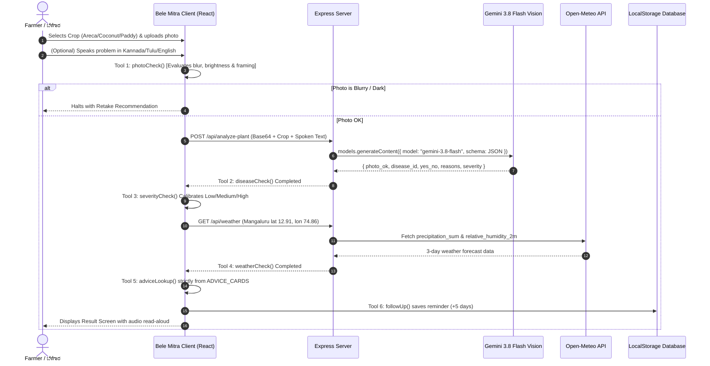

# Bele Mitra (ಬೆಳೆ ಮಿತ್ರ) 🌿
### AI Farm Helper for Smallholder Farmers in Dakshina Kannada, Karnataka, India

> **Prototype Specification**: High-contrast, dark-navy mobile-first progressive web app designed for 390px phone screens. Diagnoses sick **Areca**, **Coconut**, and **Paddy** plants, correlates findings with coastal monsoon weather, enforces verified non-hallucinatory agronomy advice, and provides a closed-loop follow-up and KVK expert triage desk.

---

## 🗺️ System Overview & Problem Statement

Dakshina Kannada (encompassing Mangaluru, Bantwal, Puttur, Sullia, Belthangady, Moodbidri, and Kadaba taluks) experiences high rainfall (3,500–4,500 mm annually) and relative humidity exceeding 85–95%. These coastal micro-climatic conditions foster fungal and bacterial plant epidemics:
1. **Areca Koleroga (Mahali / Fruit Rot)** caused by *Phytophthora meadii*.
2. **Coconut Bud Rot (ಸುಳಿ ಕೊಳೆ)** caused by *Phytophthora palmivora*.
3. **Paddy Leaf Blast (ಬೆಂಕಿ ರೋಗ)** caused by *Magnaporthe oryzae*.
4. **Areca Yellow Leaf Disease (ಹಳದಿ ಎಲೆ ರೋಗ)**.

Smallholder farmers often lack immediate access to agricultural officers and risk either catastrophic crop loss or dangerous indiscriminate chemical spraying. **Bele Mitra** solves this with an agentic diagnostic pipeline operated in **English**, **ಕನ್ನಡ (Kannada)**, or **ತುಳು (Tulu)**.

---

## 📐 Architecture & Agent Pipeline

### 1. High-Level System Architecture

```
+---------------------------------------------------------------------------------------+
|                                FARMER MOBILE INTERFACE (390px)                       |
|                                                                                       |
|   +-------------------+    +----------------------+    +--------------------------+   |
|   |   Crop Selector   |    |  Take / Upload Photo |    |  Speak Problem (WebMic)  |   |
|   |  (Areca/Coco/Rice)|    | (Camera / FilePicker)|    |  (Web Speech API: kn-IN) |   |
|   +---------+---------+    +----------+-----------+    +------------+-------------+   |
+-------------|-------------------------|-----------------------------|-----------------+
              |                         |                             |
              +-------------------------+-----------------------------+
                                        | (Base64 Image + Crop + Spoken Text)
                                        v
+---------------------------------------------------------------------------------------+
|                             BELE MITRA AGENT WORKFLOW                                 |
|                                                                                       |
|   [ Tool 1: photoCheck ] --------> Is photo sharp, well-lit & 1-2 ft distance?        |
|             |                      (If blurry/dark -> Halt early & request retake)    |
|             v                                                                         |
|   [ Tool 2: diseaseCheck ] ------> Server-side Gemini 3.8 Flash Vision Model          |
|             |                      (Structured JSON: disease_id, reasons, severity)   |
|             v                                                                         |
|   [ Tool 3: severityCheck ] -----> Calibrate plant stress (Low / Medium / High)       |
|             |                                                                         |
|             v                                                                         |
|   [ Tool 4: weatherCheck ] ------> Open-Meteo API for Mangaluru (12.91°N, 74.86°E)    |
|             |                      (3-day rain sum + humidity % + offline fallback)   |
|             v                                                                         |
|   [ Tool 5: adviceLookup ] ------> Local ADVICE_CARDS repository only                 |
|             |                      (TODAY + THIS WEEK + Mandatory KVK Warning)        |
|             v                                                                         |
|   [ Tool 6: followUp / Escalate]-> Save 5-day calendar reminder in localStorage       |
+---------------------------------------+-----------------------------------------------+
                                        |
              +-------------------------+-----------------------------+
              v                                                       v
+------------------------------------------+    +---------------------------------------+
|          FARMER RESULT SCREEN            |    |     CLOSED-LOOP EXPERT DESK (KVK)     |
|                                          |    |                                       |
| - Large YES/NO Diagnosis Banner          |    | - Case ID Tracking (#BM-YYYY-XXXX)    |
| - "Why" Visible Reasons + Weather Info   |    | - Side-by-side Day 0 vs Day 5 Photos  |
| - Severity Rating (Low / Medium / High)  |    | - Farmer voice transcript & symptoms  |
| - TODAY & THIS WEEK Cultural Actions     |    | - Officer diagnostic advice text box  |
| - Safety Strip (Gloves, Water, Children) |    | - Real-time sync back to farmer phone |
| - Text-to-Speech "Listen" (kn-IN audio)  |    +---------------------------------------+
| - 5-Day Follow-Up (Better / Same / Worse)|
+------------------------------------------+
```

---

### 2. Multi-Tool Agent Execution Sequence



---

## 📱 Screen Breakdown

### Screen 1: Home Screen
- **App Title & Subtitle**: `Bele Mitra` (ಬೆಳೆ ಮಿತ್ರ) — AI farm helper for small farmers in Dakshina Kannada.
- **Trilingual Switch**: Instant switching between **English**, **ಕನ್ನಡ (Kannada)**, and native **ತುಳು (Tulu)**.
- **Crop Picker**:
  - **Areca** (ಕಂಗು / ಅಡಿಕೆ)
  - **Coconut** (ತಾರಾಯಿ / ತೆಂಗು)
  - **Paddy** (ಬಾರ್ / ಭತ್ತ)
- **Big Action Buttons**:
  - `Take / upload photo` (direct camera access via `capture="environment"` or gallery upload).
  - `Speak your problem` (browser speech recognition supporting Kannada phonetics `kn-IN`, with real-time text transcription and common coastal symptom suggestions).
- **Offline Prototype Badge**: *"Prototype: final app runs the AI on the phone, offline."*

### Screen 2: Agent Progress Screen
A step checklist that visibly executes each tool one-by-one with animated status indicators and checkmarks:
1. `Photo check`: Evaluates focus and daylight exposure.
2. `Disease check`: Calls Gemini Vision for crop pathology classification.
3. `Severity`: Calibrates stress level.
4. `Weather (Mangaluru)`: Pulls coastal rain and humidity data.
5. `Expert advice card`: Matches symptoms against approved KVK cards.
6. `Follow-up reminder`: Prepares 5-day recovery reminder.

### Screen 3: Diagnosis Result Screen
- **Large YES/NO Answer**:
  - *"Yes, this looks like Areca Koleroga (Fruit rot)"* or *"No clear disease found"* or *"Not sure. Please retake the photo or ask an expert"*.
- **"Why:" Section**: 2 to 4 bullet points derived strictly from visible symptoms (water-soaking, nut dropping, white mycelium, discoloration) plus coastal weather risk.
- **Severity Rating**: 3 distinct icon cards for **Low**, **Medium**, and **High**.
- **What to Do (Zero Chemical Hallucinations)**:
  - **TODAY**: Urgent physical sanitation (e.g., removing dropped rotten nuts away from gardens, cleaning drainage ditches).
  - **THIS WEEK**: Officer consultation and preparation before heavy monsoon downpours.
  - **Mandatory Warning**: *"Confirm with your local agriculture officer or KVK before spraying."*
- **Safety First Strip**:
  - 🧤 Wear gloves & mask
  - 💧 Keep away from streams, open wells & drinking water
  - 🐄 Keep children & cattle away
- **"Listen" Button**: Uses Web Speech Synthesis (`SpeechSynthesisUtterance`) with `kn-IN` voice support to read out the full diagnosis and action steps to the farmer.
- **Action Triggers**:
  - `Set follow-up in 5 days` -> Transitions to follow-up schedule.
  - `Ask an expert` -> Immediately logs case into KVK expert queue.
- **"How the Agent Decided" Panel**: Collapsible diagnostic transcript listing every tool called, timestamp, and outputs.

### Screen 4: 5-Day Follow-Up Screen
- Side-by-side photo comparison: **Original Photo (Day 0)** vs. **Today's Photo**.
- Farmer taps:
  - **Better (ಸುಧಾರಿಸಿದೆ)**: Congratulates farmer, advises continued garden hygiene.
  - **Same (ಮೊದಲಿನಂತಿದೆ)**: Advises close 48-hour monitoring.
  - **Worse (ಹೆಚ್ಚಾಗಿದೆ)**: **Auto-escalation**! Flags severity as High, attaches follow-up photo, and transmits case to the agricultural officer desk.

### Screen 5: Expert Desk (KVK Agricultural Officer)
- Simple, real-time list of cases logged by farmers.
- Displays: Case tracking number (`#BM-YYYY-XXXX`), crop type, farmer voice note, original image, Day-5 follow-up image, and preliminary AI diagnosis.
- **Direct Reply Box**: Officers type verified treatment and dosage recommendations and click **"Send reply to farmer"**.
- Synced directly back to the farmer's result screen via `localStorage`.

---

## 🌿 Approved Advice Cards (`ADVICE_CARDS`)

Under strict safety principles, the AI model is **never permitted to fabricate or hallucinate chemical concentrations, dosages, or unverified pesticide mixes**. All advice is looked up strictly from verified local agricultural university / KVK guidelines:

| Disease ID | Crop | Key Visible Signs | TODAY Action | THIS WEEK Action | Mandatory Warning |
|---|---|---|---|---|---|
| `areca_koleroga` | Areca Palm (*ಕಂಗು / ಅಡಿಕೆ*) | Nuts rot and fall, dark water-soaked patches, white fungal growth in rain | Collect and destroy fallen and rotten nuts away from the garden, keep drainage clear | Ask the local agriculture officer or KVK about protective spray and right dose before/during heavy rain | Confirm with your local agriculture officer or KVK before spraying |
| `areca_yellow_leaf` | Areca Palm (*ಕಂಗು / ಅಡಿಕೆ*) | Leaves turn yellow and dry from frond tips | Mark the affected palms in the garden | Contact the KVK or horticulture officer for a garden visit | Confirm with your local agriculture officer or KVK before spraying |
| `coconut_bud_rot` | Coconut Palm (*ತಾರಾಯಿ / ತೆಂಗು*) | The youngest heart leaf turns pale and rots with foul odor | Tell the agriculture officer quickly; do not wait | Follow the officer's advice for treatment | Confirm with your local agriculture officer or KVK before spraying |
| `paddy_blast` | Paddy Rice (*ಬಾರ್ / ಭತ್ತ*) | Diamond/spindle-shaped spots with grey centres on leaves | Avoid excessive nitrogen/urea fertiliser; drain standing water | Ask the agriculture officer for the correct fungicide and dose | Confirm with your local agriculture officer or KVK before spraying |

---

## 🎨 Design Constitution (Dark Navy Theme)

The application adheres to an ergonomic dark-navy theme built for glare-reduction in sunny plantation environments:

```
[ Palette Specification ]
• Deep Background:    #070E1A (Midnight Navy)
• Surface Frame:      #0D1B2E (Deep Slate Blue)
• Card Background:    #11233B (Navy Card)
• Elevated Layers:    #142B49 (Bright Slate Card)
• Borders:            #1E3A5F / #254670 (Subtle Navy Outline)
• Primary Accent:     #2563EB / #1D4ED8 (Cobalt Action Buttons)
• Primary Text:       #F8FAFC (High-Contrast Slate White)
• Secondary Text:     #94A3B8 / #CBD5E1 (Muted Guidance Text)
• Emerald Accent:     #10B981 / #064E3B (Healthy / Recovered)
• Amber Accent:       #F59E0B / #78350F (Unsure / Moderate)
• Crimson Accent:     #EF4444 / #7F1D1D (Disease / Severe Rot)
```

- **Zero-Pill Discipline**: Button corners use consistent `rounded-xl` or `rounded-2xl` shapes without rounded pill shapes.
- **Typography**: Dual-font stack prioritizing `Plus Jakarta Sans` for English numbers and `Noto Sans Kannada` for seamless, legible rendering of Kannada and Tulu orthography.
- **Large Touch Targets**: Minimum 48px to 56px touch height for all primary buttons, operable with one hand in wet garden conditions.

---

## 🛠️ Project Structure

```
├── .env.example              # Environment variables template
├── index.html                # HTML entry point with Noto Sans Kannada font links
├── metadata.json             # AI Studio applet capabilities & metadata
├── package.json              # Express, @google/genai, React 19, Tailwind CSS dependencies
├── server.ts                 # Full-stack Express server with Gemini Vision & Open-Meteo proxy
├── tsconfig.json             # Strict TypeScript configuration
├── vite.config.ts            # Vite build configuration with Tailwind v4
└── src/
    ├── main.tsx              # React DOM entry point
    ├── index.css             # Tailwind CSS & dark theme variable configuration
    ├── App.tsx               # Primary state coordinator & screen router
    ├── data/
    │   ├── adviceCards.ts    # Single source of truth for disease advice in EN, KN, TULU
    │   └── translations.ts   # UI text dictionary in English, Kannada, and Tulu
    ├── services/
    │   └── agentWorkflow.ts  # Plain function implementations of the 6 agent tools
    └── components/
        ├── Header.tsx               # Sticky dark navy header with language switch & tab toggle
        ├── SpeechInputModal.tsx     # Web Speech recognition modal with local symptom chips
        ├── AgentProgressScreen.tsx  # Step-by-step tool checklist with live checkmarks
        ├── ResultScreen.tsx         # Comprehensive diagnosis, reasons, advice, TTS & safety strip
        ├── FollowUpScreen.tsx       # Day-5 comparative assessment with auto-escalation
        └── ExpertDeskScreen.tsx     # Agricultural officer triage queue & reply desk
```

---

## 🚀 Running Locally

### 1. Prerequisites
- Node.js 20+ installed.
- Valid Google Gemini API Key (`GEMINI_API_KEY`).

### 2. Environment Setup
Create a `.env` file in the project root:
```bash
GEMINI_API_KEY="your_actual_gemini_api_key_here"
PORT=3000
```

### 3. Installation & Startup
```bash
# Install dependencies
npm install

# Start development full-stack server (runs server.ts via tsx on port 3000)
npm run dev
```

Visit `http://localhost:3000` on your browser or mobile device.

---

## 🛡️ Security, Privacy & Safety Notes

1. **Server-Side API Key Isolation**: The Gemini API key is strictly accessed in `server.ts` via `process.env.GEMINI_API_KEY`. It is never bundled into client assets or exposed to browser execution.
2. **Local Storage Privacy**: Farmer diagnosis logs, voice notes, follow-up photos, and reminder alerts are stored directly within browser `localStorage`, ensuring zero data leakage and offline availability without requiring logins.
3. **No Chemical Fabrications**: Treatment advice is hard-coded to university-verified non-chemical sanitation steps, with all fungicide inquiries referred directly to the nearest Krishi Vigyan Kendra (KVK).
